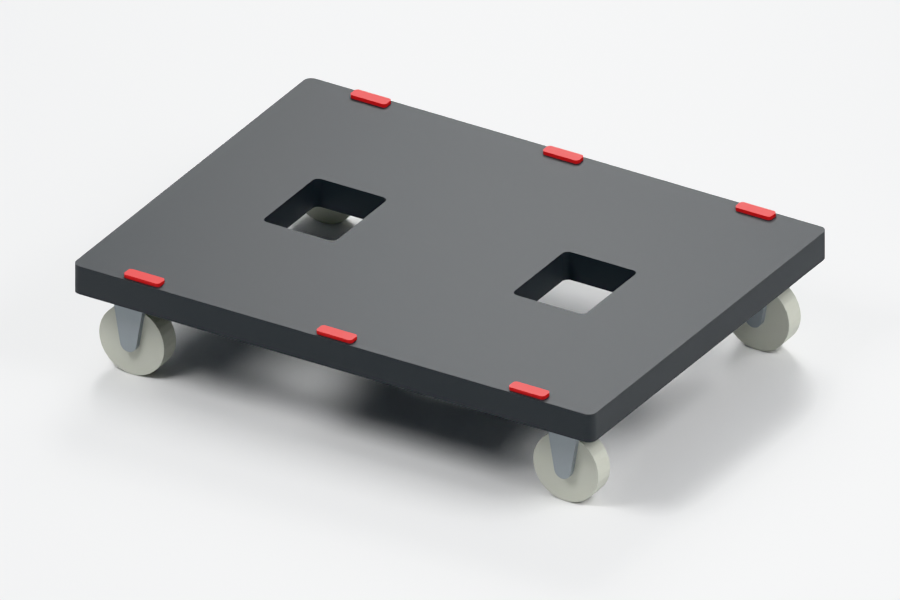
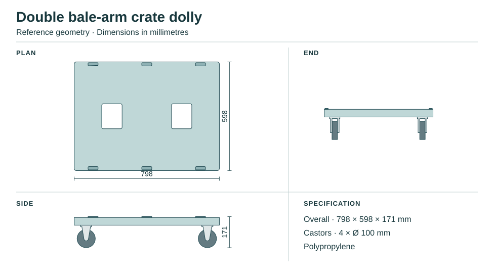

# Double bale-arm crate dolly

Carries two stacks of 600 × 400 mm crates or four stacks of 400 × 300 mm crates. Listed unit weight 9.7 kg.

| Specification | Per dolly |
| --- | --- |
| External length × width × height | 798 × 598 × 171 mm |
| Wheel diameter | 100 mm (listed) |
| Wheels | Four nylon wheels. The description specifies two fixed, one swivel and one braked swivel. The specifications table says four swivel. |
| Material | Polypropylene |
| Supplier reference | u800.600 dolly-1 |

Black deck with two openings and red retainers. Deck thickness, openings, clips, and castor positions are approximate. The model simplifies the wheel mounts and omits brake hardware. [Supplier listing · Plastic Box Sales](https://plasticboxsales.co.uk/product/800x600-plastic-double-dolly/)

## Dimensioned drawing

[Editable OpenSCAD model](three_d_model/working.scad) · [Lightweight colour model](three_d_model/working.glb) · [Full-size render](three_d_model/render.png)

Rebuild from the repository root with `python action_make_all.py --part packaging_dolly_bale_arm_crate_double_800_x_600_mm`. The supplier dimensions and modelling assumptions are in [the dolly declarations](../../working_oomp_populate_detail_dolly.py).
