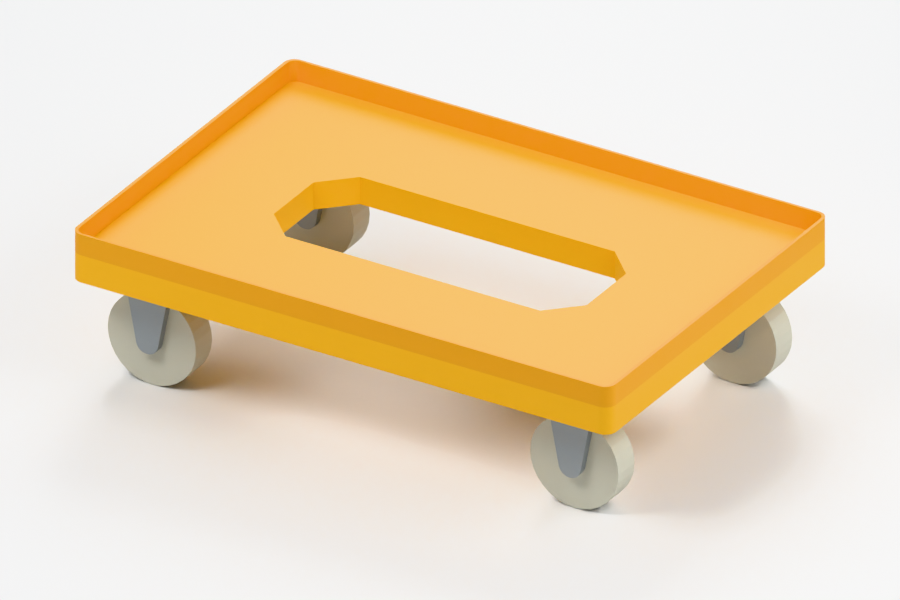
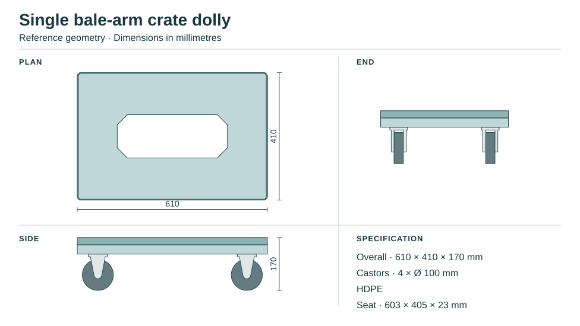

# Single bale-arm crate dolly

Fits 600 × 400 or 400 × 300 mm crates. Listed unit weight 4 kg. Sold in packs of three.

| Specification | Per dolly |
| --- | --- |
| External length × width × height | 610 × 410 × 170 mm |
| Internal seat (L × W × D) | 603 × 405 × 23 mm |
| Wheel diameter | 100 mm (listed) |
| Wheels | Four swivel castors |
| Material | HDPE |
| Supplier reference | u60.40 dolly |

Yellow example with a central opening and a raised retaining rim. Opening shape, deck thickness, and castor placement are approximate. [Supplier listing · Plastic Box Sales](https://plasticboxsales.co.uk/product/plastic-dolly-600x400-single-or-400x300-boxes-and-crates/)

## Dimensioned drawing

[Editable OpenSCAD model](three_d_model/working.scad) · [Lightweight colour model](three_d_model/working.glb) · [Full-size render](three_d_model/render.png)

Rebuild from the repository root with `python action_make_all.py --part packaging_dolly_bale_arm_crate_single_600_x_400_mm`. The supplier dimensions and modelling assumptions are in [the dolly declarations](../../working_oomp_populate_detail_dolly.py).
