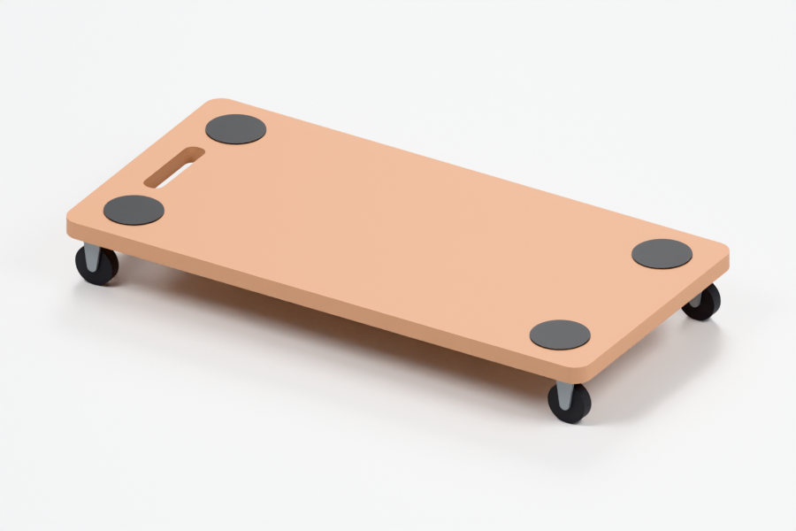
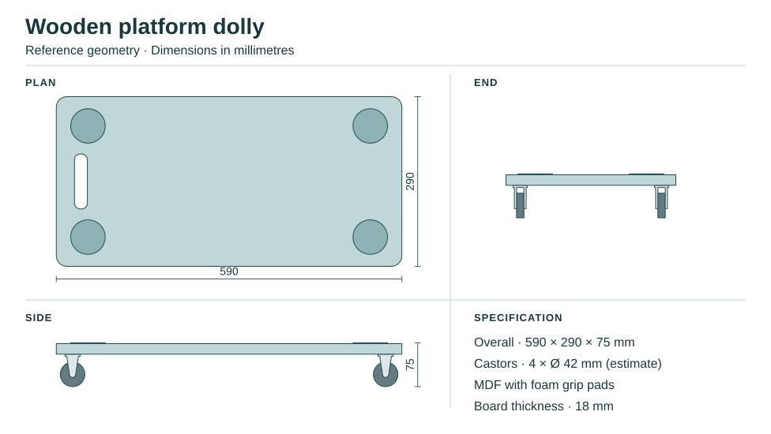

# Wooden platform dolly

Approximate platform dimensions. Sold as a pair. Seller lists a maximum load of 200 kg.

| Specification | Per dolly |
| --- | --- |
| External length × width × height | 590 × 290 × 75 mm |
| Platform thickness | 18 mm |
| Wheel diameter | 42 mm (estimated) |
| Wheels | Four castors |
| Material | MDF with foam grip pads |
| Supplier reference | eBay 355741479607 |

One platform with an integral carry slot and four foam pads. Wheel diameter, pad and slot sizes, and castor positions are estimates. [Supplier listing · Metatell](https://www.ebay.co.uk/itm/355741479607)

## Dimensioned drawing

[Editable OpenSCAD model](three_d_model/working.scad) · [Lightweight colour model](three_d_model/working.glb) · [Full-size render](three_d_model/render.png)

Rebuild from the repository root with `python action_make_all.py --part packaging_dolly_simple_590_x_290_mm`. The supplier dimensions and modelling assumptions are in [the dolly declarations](../../working_oomp_populate_detail_dolly.py).
