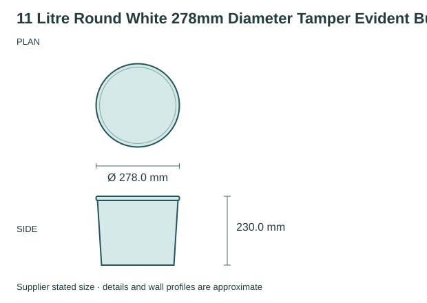

# 11 Litre Round White 278mm Diameter Tamper Evident Bucket, Handles and Lids

Supplier dimensions 278 × 278 × 230 mm (supplier listing size field).

The body taper, wall thickness, lid seating and any handle use simplified estimates. The circular reference omits the tamper-evident tab.

The handle is shown lowered and is an approximate shape.

The linked technical sheet is labelled 5.5 litre while the listing describes an 11 litre bucket. This model uses the listing size.

[Editable OpenSCAD](systempak_model.scad) · [Parameters and source](systempak_model.json) · [Seated lid](systempak_assembled.png)

[Supplier listing](https://systempak.net/product/11-litre-round-white-278mm-diameter-tamper-evident-bucket-handles-and-lids/) · [Technical sheet](https://systempak.net/wp-content/uploads/2024/03/TDS-2401-5.5L-1.pdf) · [Supplier photo](https://systempak.net/wp-content/uploads/2024/01/2402.jpg)

Regenerate with `python action_make_all.py --part packaging_takeaway_container_circle_10000_ml_capacity_278_mm_diameter_230_mm_depth_tamper_evident_systempak_2402w`.
