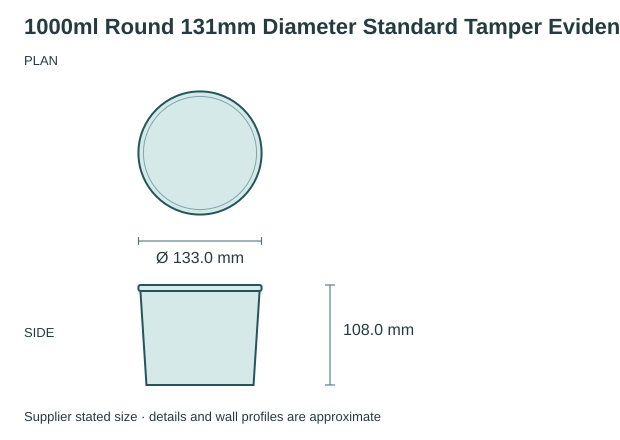

# 1000ml Round 131mm Diameter Standard Tamper Evident Containers with Handles and Lids

Supplier dimensions 133 × 133 × 108 mm (supplier listing size field).

The body taper, wall thickness, lid seating and any handle use simplified estimates. The circular reference omits the tamper-evident tab.

The handle is shown lowered and is an approximate shape.

[Editable OpenSCAD](systempak_model.scad) · [Parameters and source](systempak_model.json) · [Seated lid](systempak_assembled.png)

[Supplier listing](https://systempak.net/product/1000ml-round-131mm-diameter-tamper-evident-containers-with-handles-and-lids/) · [Technical sheet](https://systempak.net/wp-content/uploads/2024/03/TDS-2026-1000ML-2023.pdf) · [Supplier photo](https://systempak.net/wp-content/uploads/2024/03/1000ml-Round-131mm-Diameter-Tamper-Evident-Containers-with-Handles-and-Lids-2026-Close-Up.jpg)

Regenerate with `python action_make_all.py --part packaging_takeaway_container_circle_1000_ml_capacity_131_mm_diameter_108_mm_depth_tamper_evident_systempak_2026`.
