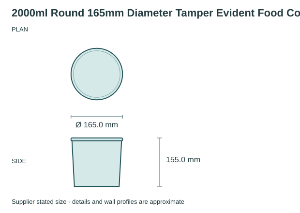

# 2000ml Round 165mm Diameter Tamper Evident Food Containers with Handles and Lids

Supplier dimensions 165 × 165 × 155 mm (supplier listing size field).

The body taper, wall thickness, lid seating and any handle use simplified estimates. The circular reference omits the tamper-evident tab.

The handle is shown lowered and is an approximate shape.

[Editable OpenSCAD](systempak_model.scad) · [Parameters and source](systempak_model.json) · [Seated lid](systempak_assembled.png)

[Supplier listing](https://systempak.net/product/2000ml-round-165mm-diameter-tamper-evident-food-containers-with-handles-and-lids/) · [Technical sheet](https://systempak.net/wp-content/uploads/2025/03/TDS-2029-2000ML.pdf) · [Supplier photo](https://systempak.net/wp-content/uploads/2025/03/2029.jpg)

Regenerate with `python action_make_all.py --part packaging_takeaway_container_circle_1500_ml_capacity_165_mm_diameter_155_mm_depth_tamper_evident_systempak_2029`.
