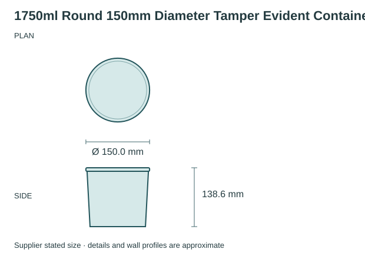

# 1750ml Round 150mm Diameter Tamper Evident Container with Handles And Lids

Supplier dimensions 150 × 150 × 138.6 mm (supplier listing size field).

The body taper, wall thickness, lid seating and any handle use simplified estimates. The circular reference omits the tamper-evident tab.

The handle is shown lowered and is an approximate shape.

[Editable OpenSCAD](systempak_model.scad) · [Parameters and source](systempak_model.json) · [Seated lid](systempak_assembled.png)

[Supplier listing](https://systempak.net/product/1750ml-round-tamperevident-container-handle-and-lid/) · [Technical sheet](https://systempak.net/wp-content/uploads/2025/08/TDS-2038DC-1750ML.pdf) · [Supplier photo](https://systempak.net/wp-content/uploads/2025/08/20250813_151409-scaled.jpg)

Regenerate with `python action_make_all.py --part packaging_takeaway_container_circle_1750_ml_capacity_150_mm_diameter_138_6_mm_depth_tamper_evident_systempak_2038`.
