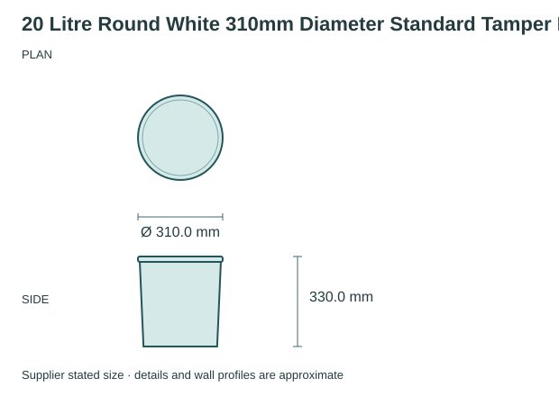

# 20 Litre Round White 310mm Diameter Standard Tamper Evident Buckets, Handles and Lids

Supplier dimensions 310 × 310 × 330 mm (supplier listing size field).

The body taper, wall thickness, lid seating and any handle use simplified estimates. The circular reference omits the tamper-evident tab.

The handle is shown lowered and is an approximate shape.

[Editable OpenSCAD](systempak_model.scad) · [Parameters and source](systempak_model.json) · [Seated lid](systempak_assembled.png)

[Supplier listing](https://systempak.net/product/20-litre-round-310mm-diameter-tamper-evident-buckets-handles-and-lids/) · [Technical sheet](https://systempak.net/wp-content/uploads/2024/03/TDS-2403W-20L.pdf) · [Supplier photo](https://systempak.net/wp-content/uploads/2024/03/20-Litre-White-Round-310mm-Diameter-Tamper-Evident-Buckets-with-Handles-and-Lids-2403-Scale-1.jpg)

Regenerate with `python action_make_all.py --part packaging_takeaway_container_circle_20000_ml_capacity_310_mm_diameter_330_mm_depth_tamper_evident_systempak_2403w`.
