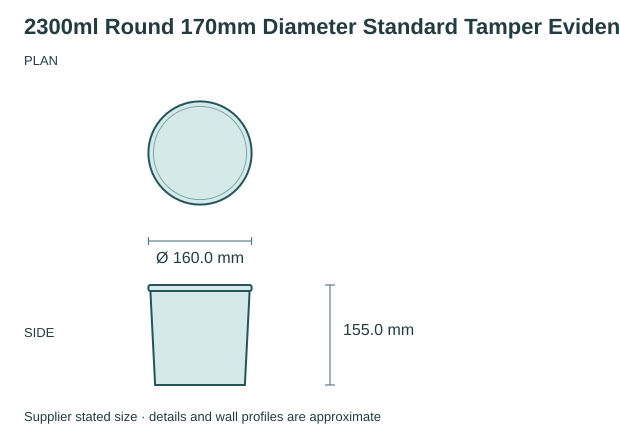

# 2300ml Round 170mm Diameter Standard Tamper Evident Container with Handles and Lids

Supplier dimensions 160 × 160 × 155 mm (supplier listing size field).

The body taper, wall thickness, lid seating and any handle use simplified estimates. The circular reference omits the tamper-evident tab.

The handle is shown lowered and is an approximate shape.

The title says 170 mm diameter while the listing size field says 160 mm. This model uses the size field.

[Editable OpenSCAD](systempak_model.scad) · [Parameters and source](systempak_model.json) · [Seated lid](systempak_assembled.png)

[Supplier listing](https://systempak.net/product/2300ml-round-170mm-diameter-tamper-evident-container-with-handles-and-lids/) · [Technical sheet](https://systempak.net/wp-content/uploads/2024/03/TDS-2031T-2300ML.pdf) · [Supplier photo](https://systempak.net/wp-content/uploads/2024/03/2300ml-Round-170mm-Diameter-Tamper-Evident-Container-with-Handles-and-Lids-2031-Close-Up.jpg)

Regenerate with `python action_make_all.py --part packaging_takeaway_container_circle_2000_ml_capacity_170_mm_diameter_155_mm_depth_tamper_evident_systempak_2031`.
