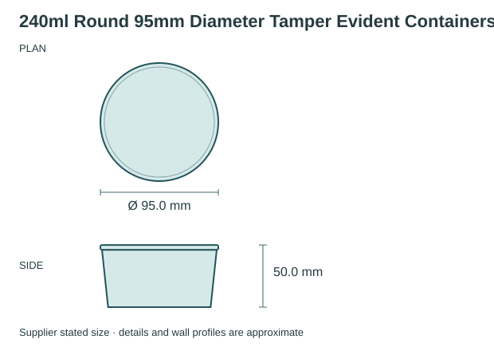

# 240ml Round 95mm Diameter Tamper Evident Containers and Lids

Supplier dimensions 95 × 95 × 50 mm (supplier listing size field).

The body taper, wall thickness, lid seating and any handle use simplified estimates. The circular reference omits the tamper-evident tab.

[Editable OpenSCAD](systempak_model.scad) · [Parameters and source](systempak_model.json) · [Seated lid](systempak_assembled.png)

[Supplier listing](https://systempak.net/product/240ml-round-95mm-diameter-tamper-evident-containers-and-lids/) · [Technical sheet](https://systempak.net/wp-content/uploads/2024/03/TDS-2033-240ML.pdf) · [Supplier photo](https://systempak.net/wp-content/uploads/2024/03/240ml-Round-95mm-Diameter-Tamper-Evident-Containers-and-Lids-2033-Close-Up-IML-Label-1.jpg)

Regenerate with `python action_make_all.py --part packaging_takeaway_container_circle_240_ml_capacity_95_mm_diameter_50_mm_depth_tamper_evident_systempak_2033`.
