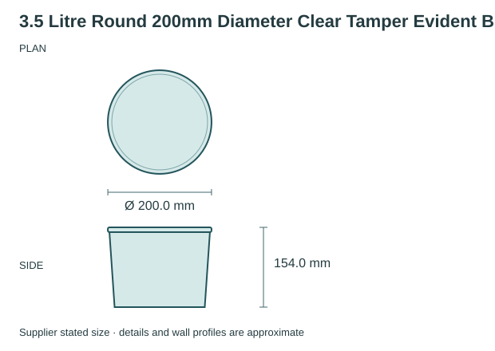

# 3.5 Litre Round 200mm Diameter Clear Tamper Evident Buckets with Handles and Lids

Supplier dimensions 200 × 200 × 154 mm (supplier listing size field).

The body taper, wall thickness, lid seating and any handle use simplified estimates. The circular reference omits the tamper-evident tab.

The handle is shown lowered and is an approximate shape.

The title specifies clear while the colour field says white. The render follows the title.

[Editable OpenSCAD](systempak_model.scad) · [Parameters and source](systempak_model.json) · [Seated lid](systempak_assembled.png)

[Supplier listing](https://systempak.net/product/3-5-litre-round-200mm-diameter-clear-tamper-evident-buckets-with-handles-and-lids/) · [Technical sheet](https://systempak.net/wp-content/uploads/2024/04/TDS-2400-3.5L.pdf) · [Supplier photo](https://systempak.net/wp-content/uploads/2024/03/3-Litre-Round-200mm-Diameter-Tamper-Evident-Buckets-with-Handles-and-Lids-2400-Close-Up.jpg)

Regenerate with `python action_make_all.py --part packaging_takeaway_container_circle_3000_ml_capacity_200_mm_diameter_154_mm_depth_tamper_evident_systempak_2400c`.
