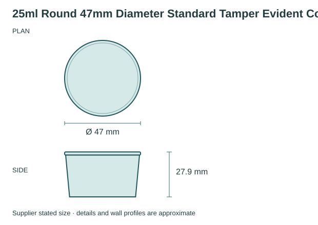

# 25ml Round 47mm Diameter Standard Tamper Evident Containers and Lids

Supplier dimensions 47 × 47 × 27.9 mm (supplier technical sheet, container dimensions).

The body taper, wall thickness, lid seating and any handle use simplified estimates. The circular reference omits the tamper-evident tab.

The listing title says 25 ml while the legacy OOMP identifier says 30 ml. Dimensions follow the technical sheet.

[Editable OpenSCAD](systempak_model.scad) · [Parameters and source](systempak_model.json) · [Seated lid](systempak_assembled.png)

[Supplier listing](https://systempak.net/product/25ml-round-clear-tamper-evident-container-lids/) · [Technical sheet](https://systempak.net/wp-content/uploads/2024/04/TDS-2001-25ML.pdf) · [Supplier photo](https://systempak.net/wp-content/uploads/2024/03/25ml-Round-47mm-Diameter-Standard-Tamper-Evident-Containers-and-Lids-2001-Close-Up.jpg)

Regenerate with `python action_make_all.py --part packaging_takeaway_container_circle_30_ml_capacity_47_mm_diameter_tamper_evident_systempak_2001`.
