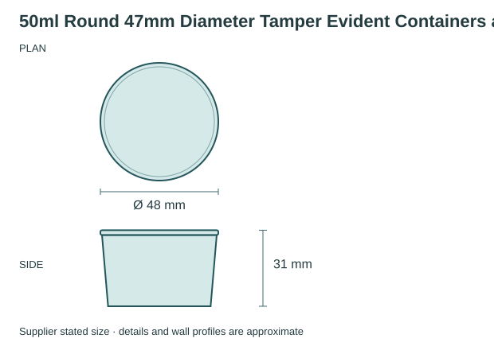

# 50ml Round 47mm Diameter Tamper Evident Containers and Lids

Supplier dimensions 48 × 48 × 31 mm (supplier technical sheet, container dimensions).

The body taper, wall thickness, lid seating and any handle use simplified estimates. The circular reference omits the tamper-evident tab.

The technical sheet states a 48 mm diameter while the listing title and OOMP identifier say 47 mm.

[Editable OpenSCAD](systempak_model.scad) · [Parameters and source](systempak_model.json) · [Seated lid](systempak_assembled.png)

[Supplier listing](https://systempak.net/product/50ml-round-47mm-diameter-standard-tamper-evident-containers-and-lids/) · [Technical sheet](https://systempak.net/wp-content/uploads/2024/04/TDS-2002-50ML.pdf) · [Supplier photo](https://systempak.net/wp-content/uploads/2024/03/50ml-Round-47mm-Diameter-Standard-Tamper-Evident-Containers-and-Lids-2002-Close-Up.jpg)

Regenerate with `python action_make_all.py --part packaging_takeaway_container_circle_50_ml_capacity_47_mm_diameter_tamper_evident_systempak_2002`.
