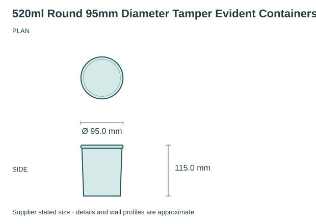

# 520ml Round 95mm Diameter Tamper Evident Containers

Supplier dimensions 95 × 95 × 115 mm (supplier listing size field).

The body taper, wall thickness, lid seating and any handle use simplified estimates. The circular reference omits the tamper-evident tab.

[Editable OpenSCAD](systempak_model.scad) · [Parameters and source](systempak_model.json) · [Seated lid](systempak_assembled.png)

[Supplier listing](https://systempak.net/product/520ml-round-95mm-diameter-standard-tamper-evident-containers/) · [Technical sheet](https://systempak.net/wp-content/uploads/2024/04/TDS-2015-520ML.pdf) · [Supplier photo](https://systempak.net/wp-content/uploads/2024/03/520ml-Round-95mm-Diameter-Standard-2015C-Close-Up.jpg)

Regenerate with `python action_make_all.py --part packaging_takeaway_container_circle_520_ml_capacity_95_mm_diameter_115_mm_depth_tamper_evident_systempak_2015`.
