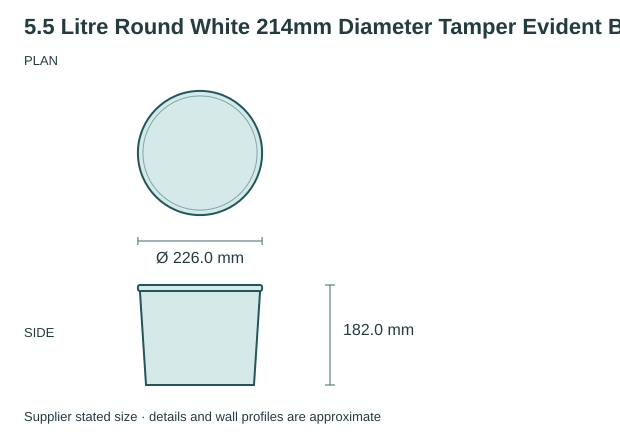

# 5.5 Litre Round White 214mm Diameter Tamper Evident Buckets, Handles and Lids

Supplier dimensions 226 × 226 × 182 mm (supplier listing size field).

The body taper, wall thickness, lid seating and any handle use simplified estimates. The circular reference omits the tamper-evident tab.

The handle is shown lowered and is an approximate shape.

The title gives a nominal 214 mm diameter while the size field says 226 mm. This model uses the size field.

[Editable OpenSCAD](systempak_model.scad) · [Parameters and source](systempak_model.json) · [Seated lid](systempak_assembled.png)

[Supplier listing](https://systempak.net/product/5-5-litre-round-214mm-diameter-tamper-evident-buckets-handles-and-lids/) · [Technical sheet](https://systempak.net/wp-content/uploads/2024/03/TDS-2401W-5.5L-1.pdf) · [Supplier photo](https://systempak.net/wp-content/uploads/2024/03/5-Litre-White-Round-214mm-Diameter-Tamper-Evident-Buckets-with-Handles-and-Lids-2401-Close-Up.jpg)

Regenerate with `python action_make_all.py --part packaging_takeaway_container_circle_5500_ml_capacity_214_mm_diameter_182_mm_depth_tamper_evident_systempak_2401w`.
