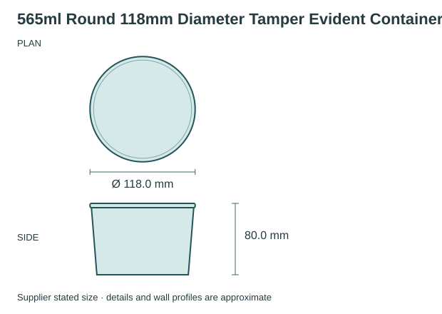

# 565ml Round 118mm Diameter Tamper Evident Container and Lids

Supplier dimensions 118 × 118 × 80 mm (supplier listing size field).

The body taper, wall thickness, lid seating and any handle use simplified estimates. The circular reference omits the tamper-evident tab.

[Editable OpenSCAD](systempak_model.scad) · [Parameters and source](systempak_model.json) · [Seated lid](systempak_assembled.png)

[Supplier listing](https://systempak.net/product/565ml-round-118mm-diameter-tamper-evident-container-and-lids/) · [Technical sheet](https://systempak.net/wp-content/uploads/2024/04/TDS-2020-565ML.pdf) · [Supplier photo](https://systempak.net/wp-content/uploads/2024/03/565ml-Round-118mm-Diameter-Tamper-Evident-Container-and-Lids-2020-Close-Up.jpg)

Regenerate with `python action_make_all.py --part packaging_takeaway_container_circle_565_ml_capacity_118_mm_diameter_80_mm_depth_tamper_evident_systempak_2020`.
