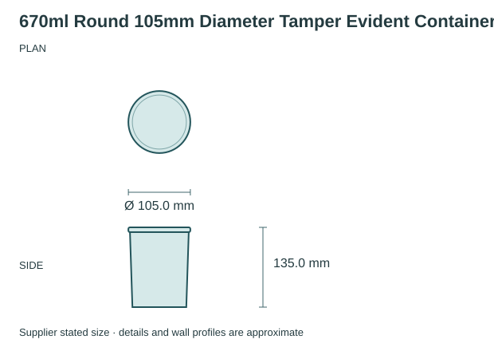

# 670ml Round 105mm Diameter Tamper Evident Containers and Lids

Supplier dimensions 105 × 105 × 135 mm (supplier listing size field).

The body taper, wall thickness, lid seating and any handle use simplified estimates. The circular reference omits the tamper-evident tab.

[Editable OpenSCAD](systempak_model.scad) · [Parameters and source](systempak_model.json) · [Seated lid](systempak_assembled.png)

[Supplier listing](https://systempak.net/product/670ml-round-105mm-diameter-tamper-evident-containers-and-lids/) · [Technical sheet](https://systempak.net/wp-content/uploads/2024/04/254-REUPDATED.pdf) · [Supplier photo](https://systempak.net/wp-content/uploads/2024/03/2024-670ml-clear-Hero.jpg)

Regenerate with `python action_make_all.py --part packaging_takeaway_container_circle_670_ml_capacity_105_mm_diameter_135_mm_depth_tamper_evident_systempak_254`.
