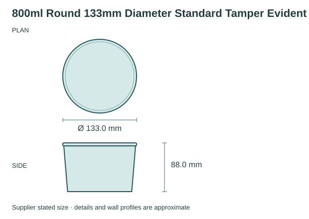

# 800ml Round 133mm Diameter Standard Tamper Evident Containers and Lids

Supplier dimensions 133 × 133 × 88 mm (supplier listing size field).

The body taper, wall thickness, lid seating and any handle use simplified estimates. The circular reference omits the tamper-evident tab.

[Editable OpenSCAD](systempak_model.scad) · [Parameters and source](systempak_model.json) · [Seated lid](systempak_assembled.png)

[Supplier listing](https://systempak.net/product/800ml-round-131mm-diameter-standard-tamper-evident-containers-lids-and-handles/) · [Technical sheet](https://systempak.net/wp-content/uploads/2024/03/TDS-2025-800MLBULK.pdf) · [Supplier photo](https://systempak.net/wp-content/uploads/2024/03/2025B.jpg)

Regenerate with `python action_make_all.py --part packaging_takeaway_container_circle_800_ml_capacity_133_mm_diameter_88_mm_depth_tamper_evident_systempak_2025`.
