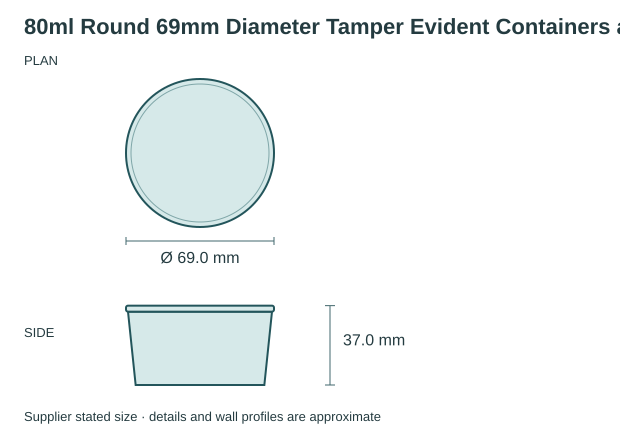

# 80ml Round 69mm Diameter Tamper Evident Containers and Lids

Supplier dimensions 69 × 69 × 37 mm (supplier listing size field).

The body taper, wall thickness, lid seating and any handle use simplified estimates. The circular reference omits the tamper-evident tab.

[Editable OpenSCAD](systempak_model.scad) · [Parameters and source](systempak_model.json) · [Seated lid](systempak_assembled.png)

[Supplier listing](https://systempak.net/product/80ml-round-69mm-diameter-tamper-evident-containers-and-lids/) · [Technical sheet](https://systempak.net/wp-content/uploads/2024/03/TDS-2003-80ML-1.pdf) · [Supplier photo](https://systempak.net/wp-content/uploads/2024/03/80ml-Round-69mm-Diameter-Standard-Tamper-Evident-Containers-and-Lids-2003-Close-Up.jpg)

Regenerate with `python action_make_all.py --part packaging_takeaway_container_circle_80_ml_capacity_69_mm_diameter_37_mm_depth_tamper_evident_systempak_2003`.
