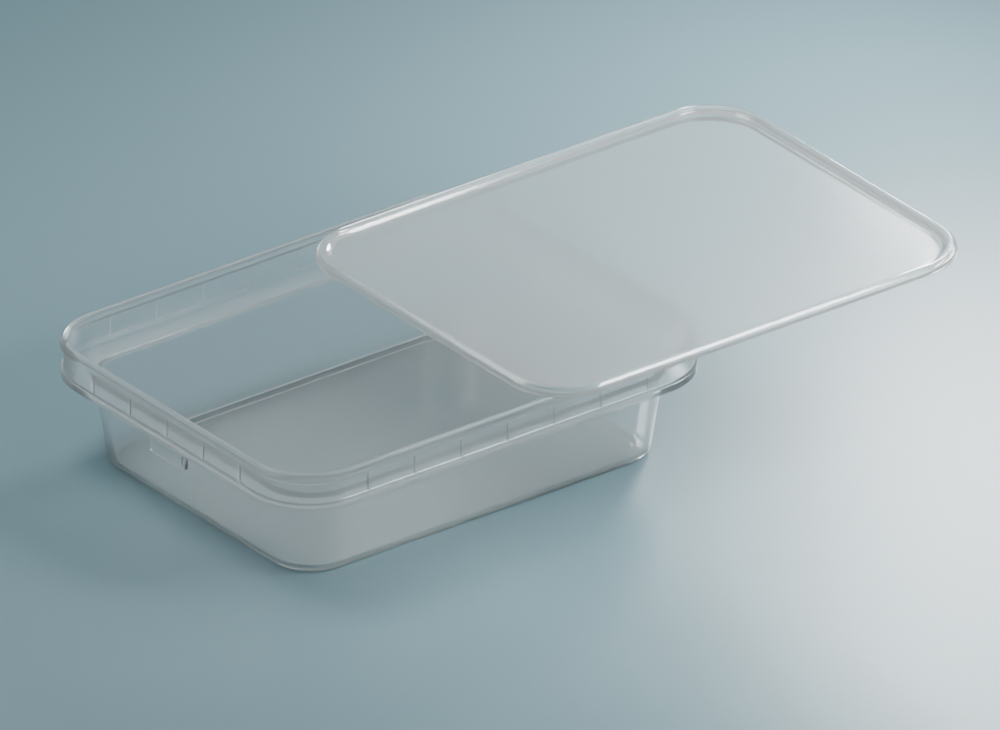

# SystemPAK 209 reference model

Open pot 108 × 86 × 27 mm. Closed envelope 109 × 86 × 29 mm. Bare and closed envelopes use the technical sheet and product listing respectively. Radius, wall, taper, skirt, foot and tab profile are estimates from the close-up. Capacity is the labelled product capacity.

[3D model with removable lid](systempak.glb) · [Seated lid render](assembled.png) · [Open pot](body.stl) · [Removable lid](lid.stl) · [Assembled OpenSCAD view](assembled.scad) · [Parameters and provenance](model.json)

[SystemPAK listing](https://systempak.net/product/100ml-rectangular-tamper-evident-containers-and-lids/) · [Technical sheet](https://systempak.net/wp-content/uploads/2024/03/TDS-209-100ML.pdf) · [Reference photo](https://systempak.net/wp-content/uploads/2024/03/100ml-Rectangular-Tamper-Evident-Containers-and-Lids-209-Close-Up.jpg)

From the packaging project root run `python action_make_all.py --part packaging_takeaway_container_rectangle_100_ml_capacity_109_mm_width_86_mm_height_29_mm_depth_tamper_evident_systempak_209`. The same registered model runs during the full make-all. Edit `models/systempak/209.json` to change the profile.
