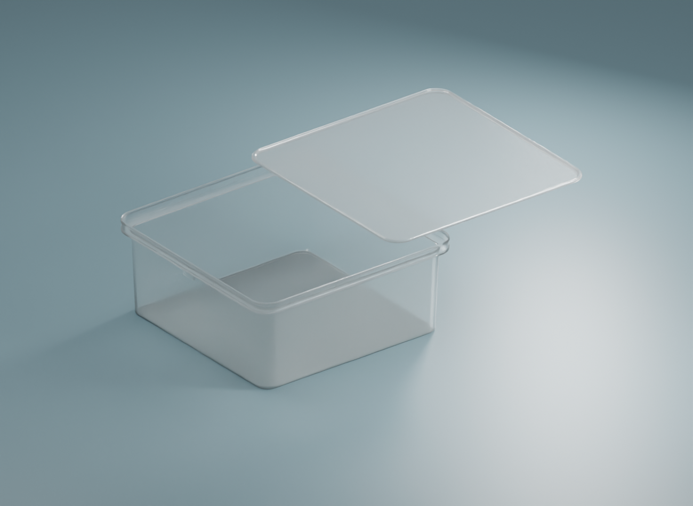
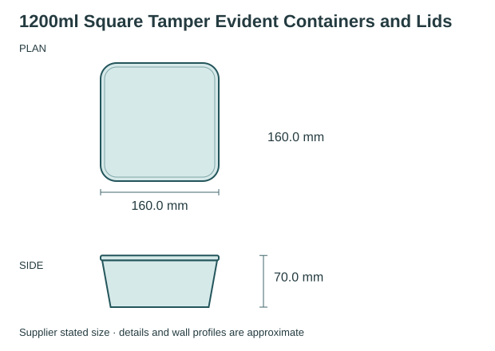

# 1200ml Square Tamper Evident Containers and Lids

Supplier dimensions 160 × 160 × 70 mm (supplier listing size field).

The body taper, wall thickness, lid seating and tab use simplified estimates.

[Editable OpenSCAD](systempak_model.scad) · [Parameters and source](systempak_model.json) · [Seated lid](systempak_assembled.png)

[Supplier listing](https://systempak.net/product/1200ml-square-tamper-evident-containers-and-lids/) · [Technical sheet](https://systempak.net/wp-content/uploads/2025/02/TDS-219-1200ML.pdf) · [Supplier photo](https://systempak.net/wp-content/uploads/2025/02/219-1-scaled.jpg)

Regenerate with `python action_make_all.py --part packaging_takeaway_container_rectangle_1200_ml_capacity_160_mm_width_160_mm_height_70_mm_depth_tamper_evident_systempak_219`.
