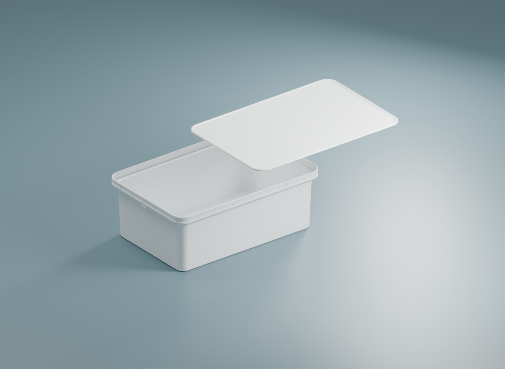
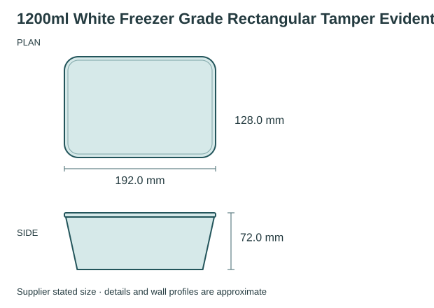

# 1200ml White Freezer Grade Rectangular Tamper Evident Containers and Lids

Supplier dimensions 192 × 128 × 72 mm (supplier listing size field).

The body taper, wall thickness, lid seating and tab use simplified estimates.

The title specifies white while the colour field says clear. The render follows the title.

[Editable OpenSCAD](systempak_model.scad) · [Parameters and source](systempak_model.json) · [Seated lid](systempak_assembled.png)

[Supplier listing](https://systempak.net/product/1200ml-white-freezer-grade-rectangular-tamper-evident-containers-and-lids/) · [Technical sheet](https://systempak.net/wp-content/uploads/2024/04/TDS-2106W-1200ML.pdf) · [Supplier photo](https://systempak.net/wp-content/uploads/2024/03/1200ml-White-Rectangular-Tamper-Evident-Containers-and-Lids-2106-Close-Up.jpg)

Regenerate with `python action_make_all.py --part packaging_takeaway_container_rectangle_1200_ml_capacity_192_mm_width_128_mm_height_72_mm_depth_tamper_evident_systempak_2106w`.
