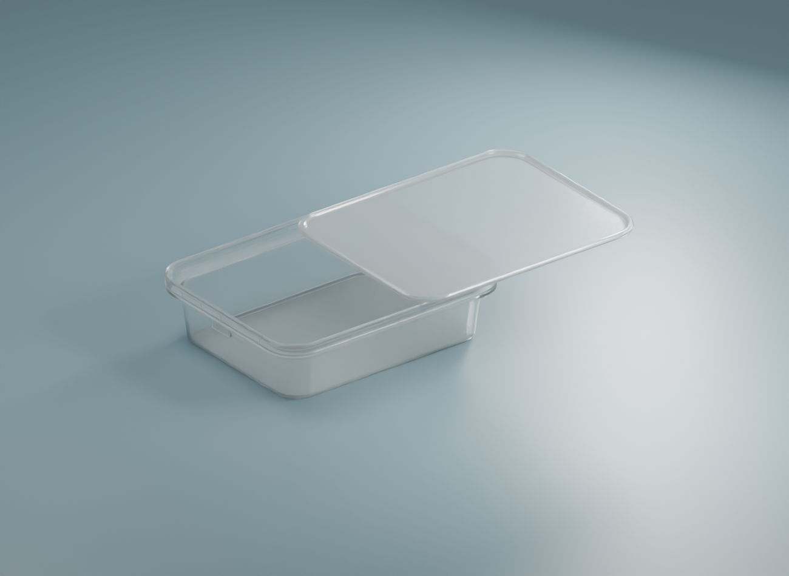
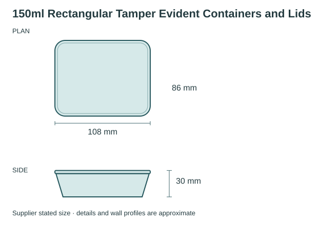

# 150ml Rectangular Tamper Evident Containers and Lids

Supplier dimensions 108 × 86 × 30 mm (supplier technical sheet, container dimensions).

The body taper, wall thickness, lid seating and tab use simplified estimates.

[Editable OpenSCAD](systempak_model.scad) · [Parameters and source](systempak_model.json) · [Seated lid](systempak_assembled.png)

[Supplier listing](https://systempak.net/product/150ml-plastic-rectangular-tamper-evident-deli-food-container-and-lid/) · [Technical sheet](https://systempak.net/wp-content/uploads/2024/03/TDS-210-150ML-1.pdf) · [Supplier photo](https://systempak.net/wp-content/uploads/2024/03/150ml-Rectangular-Tamper-Evident-Containers-and-Lids-210-Close-Up.jpg)

Regenerate with `python action_make_all.py --part packaging_takeaway_container_rectangle_150_ml_capacity_109_mm_width_86_mm_height_29_mm_depth_tamper_evident_systempak_210`.
