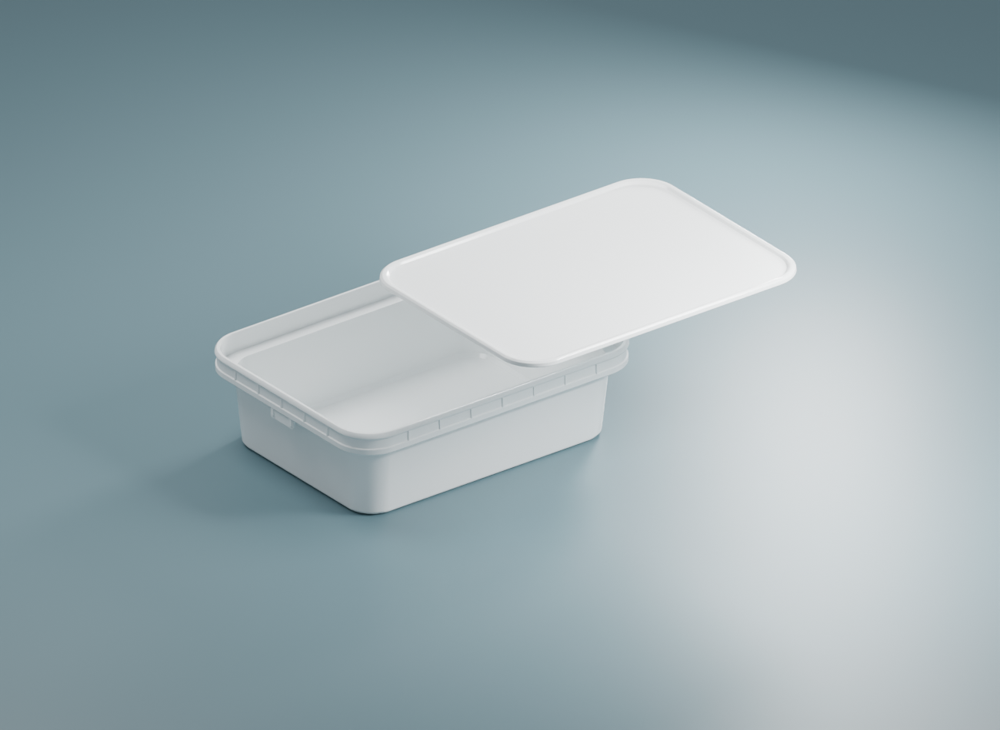
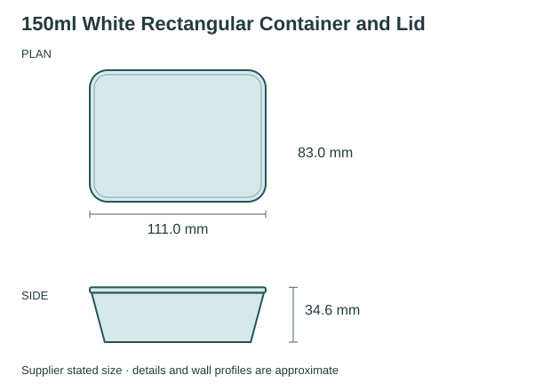

# 150ml White Rectangular Container and Lid

Supplier dimensions 111 × 83 × 34.6 mm (supplier listing size field).

The body taper, wall thickness, lid seating and tab use simplified estimates.

[Editable OpenSCAD](systempak_model.scad) · [Parameters and source](systempak_model.json) · [Seated lid](systempak_assembled.png)

[Supplier listing](https://systempak.net/product/150ml-white-rectangular-pate-container-lid/) · [Supplier photo](https://systempak.net/wp-content/uploads/2024/10/5008W.png)

Regenerate with `python action_make_all.py --part packaging_takeaway_container_rectangle_150_ml_capacity_111_mm_width_83_mm_height_34_6_mm_depth_tamper_evident_systempak_5008w`.
