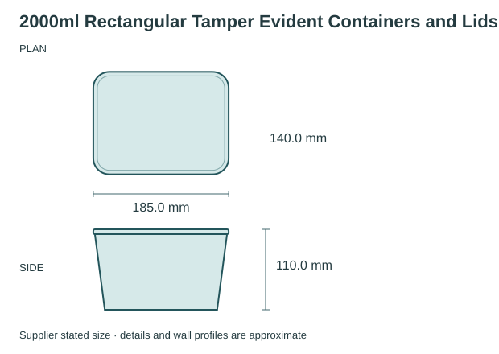

# 2000ml Rectangular Tamper Evident Containers and Lids

Supplier dimensions 185 × 140 × 110 mm (supplier listing size field).

The body taper, wall thickness, lid seating and tab use simplified estimates.

[Editable OpenSCAD](systempak_model.scad) · [Parameters and source](systempak_model.json) · [Seated lid](systempak_assembled.png)

[Supplier listing](https://systempak.net/product/2000ml-rectangular-tamper-evident-containers-and-lids/) · [Technical sheet](https://systempak.net/wp-content/uploads/2024/03/TDS-2108-2000ML.pdf) · [Supplier photo](https://systempak.net/wp-content/uploads/2024/03/2108-2000ml-Hero-min.jpg)

Regenerate with `python action_make_all.py --part packaging_takeaway_container_rectangle_2000_ml_capacity_185_mm_width_140_mm_height_110_mm_depth_tamper_evident_systempak_2108`.
