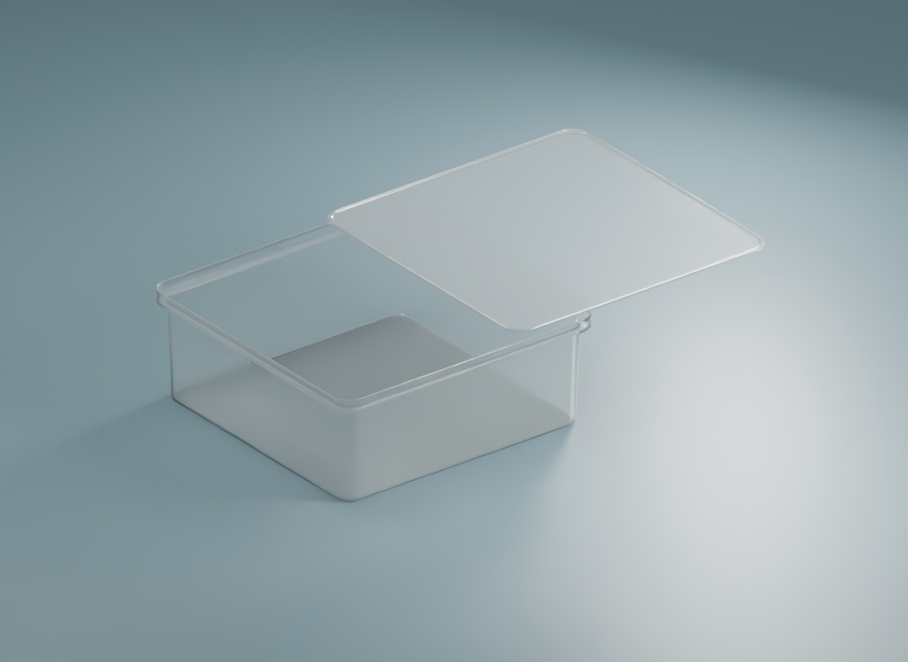
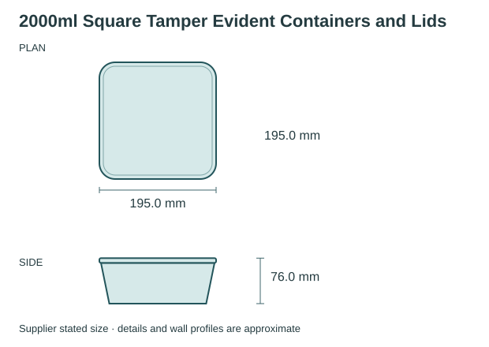

# 2000ml Square Tamper Evident Containers and Lids

Supplier dimensions 195 × 195 × 76 mm (supplier listing size field).

The body taper, wall thickness, lid seating and tab use simplified estimates.

[Editable OpenSCAD](systempak_model.scad) · [Parameters and source](systempak_model.json) · [Seated lid](systempak_assembled.png)

[Supplier listing](https://systempak.net/product/2000ml-square-tamper-evident-containers-and-lids/) · [Technical sheet](https://systempak.net/wp-content/uploads/2024/04/TDS-2304-2000ML.pdf) · [Supplier photo](https://systempak.net/wp-content/uploads/2024/03/2000ml-Square-Tamper-Evident-Containers-and-Lids-2304-Close-Up.jpg)

Regenerate with `python action_make_all.py --part packaging_takeaway_container_rectangle_2000_ml_capacity_195_mm_width_195_mm_height_76_mm_depth_tamper_evident_systempak_2304`.
