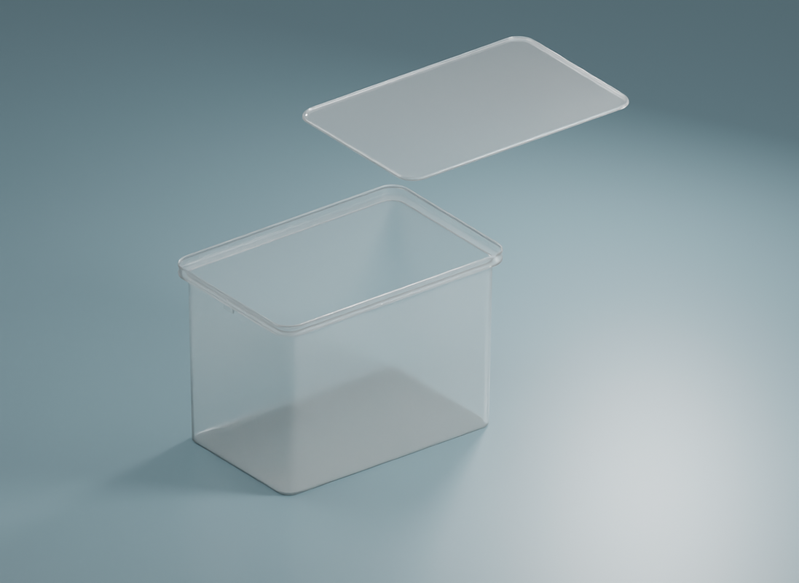
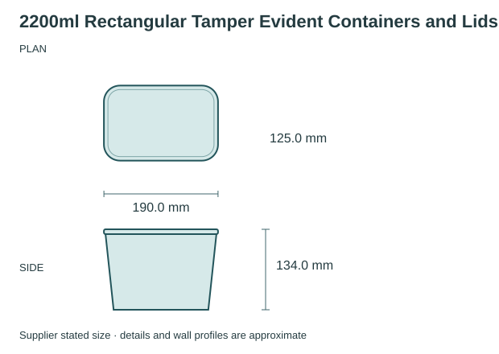

# 2200ml Rectangular Tamper Evident Containers and Lids

Supplier dimensions 190 × 125 × 134 mm (supplier listing size field).

The body taper, wall thickness, lid seating and tab use simplified estimates.

[Editable OpenSCAD](systempak_model.scad) · [Parameters and source](systempak_model.json) · [Seated lid](systempak_assembled.png)

[Supplier listing](https://systempak.net/product/2200ml-rectangular-tamper-evident-containers-and-lids/) · [Technical sheet](https://systempak.net/wp-content/uploads/2025/02/TDS-218-2200ML.pdf) · [Supplier photo](https://systempak.net/wp-content/uploads/2025/02/218-6.jpg)

Regenerate with `python action_make_all.py --part packaging_takeaway_container_rectangle_2200_ml_capacity_190_mm_width_125_mm_height_134_mm_depth_tamper_evident_systempak_218`.
