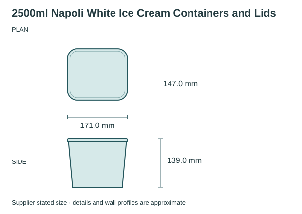

# 2500ml Napoli White Ice Cream Containers and Lids

Supplier dimensions 171 × 147 × 139 mm (supplier listing size field).

The body taper, wall thickness, lid seating and tab use simplified estimates.

[Editable OpenSCAD](systempak_model.scad) · [Parameters and source](systempak_model.json) · [Seated lid](systempak_assembled.png)

[Supplier listing](https://systempak.net/product/2500ml-napoli-white-ice-cream-containers-and-lids/) · [Technical sheet](https://systempak.net/wp-content/uploads/2024/04/TDS-2111-2500ML-1.pdf) · [Supplier photo](https://systempak.net/wp-content/uploads/2024/03/2500ml-Napoli-White-Ice-Cream-Containers-and-Lids-2111-Close-Up.jpg)

Regenerate with `python action_make_all.py --part packaging_takeaway_container_rectangle_2500_ml_capacity_171_mm_width_147_mm_height_139_mm_depth_tamper_evident_systempak_2111`.
