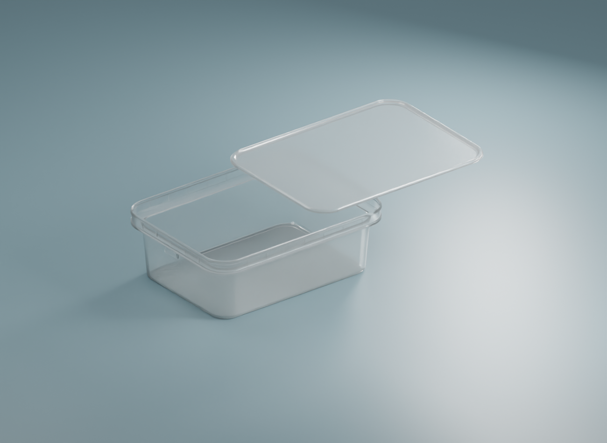
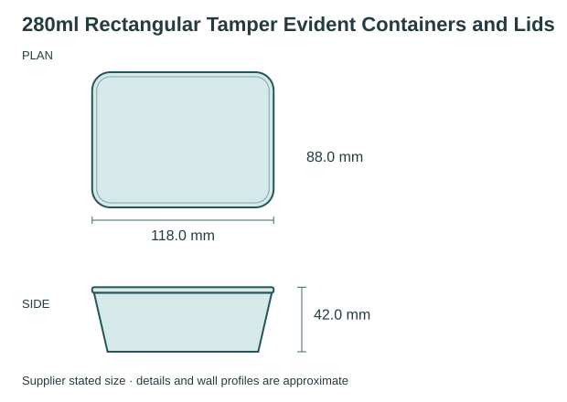

# 280ml Rectangular Tamper Evident Containers and Lids

Supplier dimensions 118 × 88 × 42 mm (supplier listing size field).

The body taper, wall thickness, lid seating and tab use simplified estimates.

[Editable OpenSCAD](systempak_model.scad) · [Parameters and source](systempak_model.json) · [Seated lid](systempak_assembled.png)

[Supplier listing](https://systempak.net/product/280ml-rectangular-tamper-evident-containers-and-lids/) · [Technical sheet](https://systempak.net/wp-content/uploads/2024/03/TDS-2102MC-280ML.pdf) · [Supplier photo](https://systempak.net/wp-content/uploads/2024/03/280ml-Rectangular-Tamper-Evident-Containers-and-Lids-2102-Close-Up.jpg)

Regenerate with `python action_make_all.py --part packaging_takeaway_container_rectangle_280_ml_capacity_118_mm_width_88_mm_height_42_mm_depth_tamper_evident_systempak_2102`.
