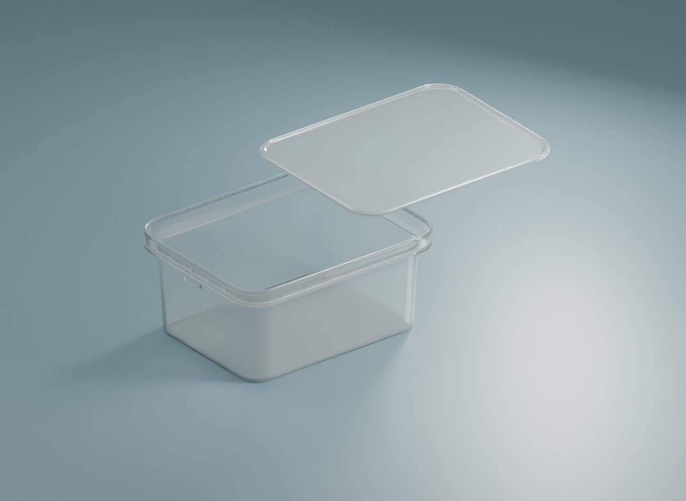
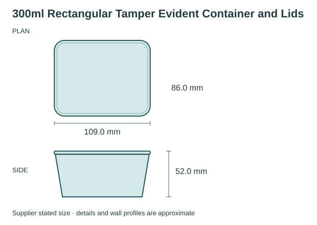

# 300ml Rectangular Tamper Evident Container and Lids

Supplier dimensions 109 × 86 × 52 mm (supplier listing size field).

The body taper, wall thickness, lid seating and tab use simplified estimates.

[Editable OpenSCAD](systempak_model.scad) · [Parameters and source](systempak_model.json) · [Seated lid](systempak_assembled.png)

[Supplier listing](https://systempak.net/product/300ml-rectangular-tamper-evident-container-and-lids/) · [Supplier photo](https://systempak.net/wp-content/uploads/2024/03/300ml-Rectangular-Tamper-Evident-Containers-and-Lids-213-Close-Up.jpg)

Regenerate with `python action_make_all.py --part packaging_takeaway_container_rectangle_300_ml_capacity_109_mm_width_86_mm_height_52_mm_depth_tamper_evident_systempak_213`.
