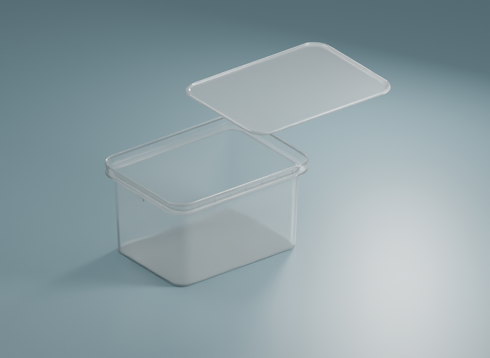
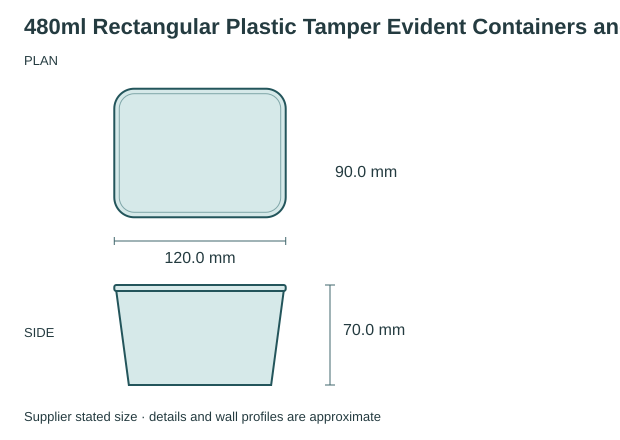

# 480ml Rectangular Plastic Tamper Evident Containers and lids

Supplier dimensions 120 × 90 × 70 mm (supplier listing size field).

The body taper, wall thickness, lid seating and tab use simplified estimates.

[Editable OpenSCAD](systempak_model.scad) · [Parameters and source](systempak_model.json) · [Seated lid](systempak_assembled.png)

[Supplier listing](https://systempak.net/product/480ml-rectangular-plastic-tamper-evident-containers-and-lids/) · [Technical sheet](https://systempak.net/wp-content/uploads/2024/04/TDS-2109FG-480ML.pdf) · [Supplier photo](https://systempak.net/wp-content/uploads/2024/03/500ml-Rectangular-Tamper-Evident-Containers-and-Lids-215-Close-Up.jpg)

Regenerate with `python action_make_all.py --part packaging_takeaway_container_rectangle_480_ml_capacity_120_mm_width_90_mm_height_70_mm_depth_tamper_evident_systempak_2109`.
