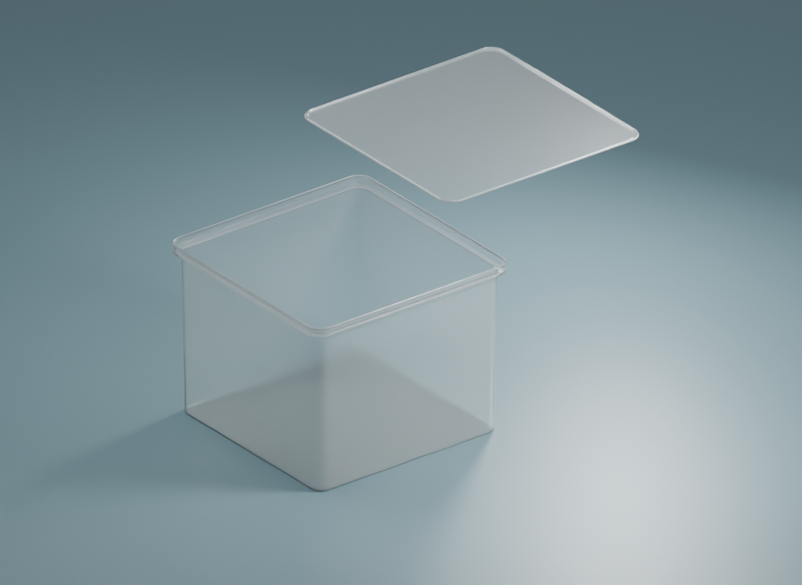
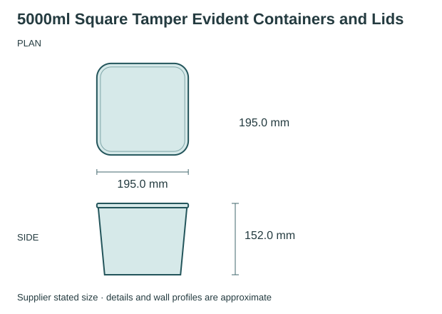

# 5000ml Square Tamper Evident Containers and Lids

Supplier dimensions 195 × 195 × 152 mm (supplier listing size field).

The body taper, wall thickness, lid seating and tab use simplified estimates.

[Editable OpenSCAD](systempak_model.scad) · [Parameters and source](systempak_model.json) · [Seated lid](systempak_assembled.png)

[Supplier listing](https://systempak.net/product/5000ml-square-tamper-evident-containers-and-lids-2/) · [Technical sheet](https://systempak.net/wp-content/uploads/2024/03/TDS-2308-5000ML.pdf) · [Supplier photo](https://systempak.net/wp-content/uploads/2024/03/5000ml-Square-Tamper-Evident-Containers-and-Lids-2308-Close-Up.jpg)

Regenerate with `python action_make_all.py --part packaging_takeaway_container_rectangle_5000_ml_capacity_195_mm_width_195_mm_height_152_mm_depth_tamper_evident_systempak_2308`.
