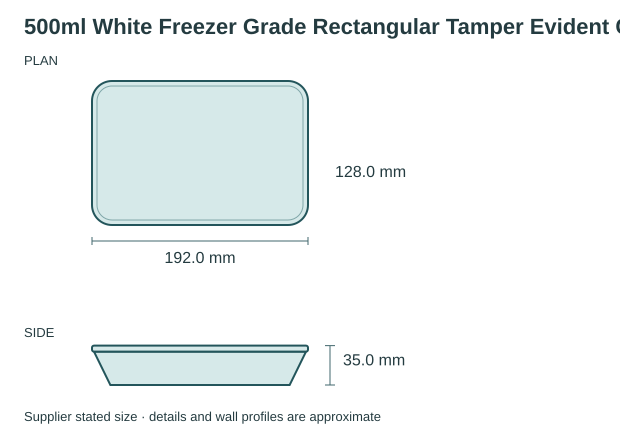

# 500ml White Freezer Grade Rectangular Tamper Evident Containers and Lids

Supplier dimensions 192 × 128 × 35 mm (supplier listing size field).

The body taper, wall thickness, lid seating and tab use simplified estimates.

[Editable OpenSCAD](systempak_model.scad) · [Parameters and source](systempak_model.json) · [Seated lid](systempak_assembled.png)

[Supplier listing](https://systempak.net/product/500ml-white-freezer-grade-rectangular-tamper-evident-containers-and-lids/) · [Technical sheet](https://systempak.net/wp-content/uploads/2025/02/TDS-2103FG-500ML.pdf) · [Supplier photo](https://systempak.net/wp-content/uploads/2024/03/2103CFG-500ml-Hero-min.jpg)

Regenerate with `python action_make_all.py --part packaging_takeaway_container_rectangle_500_ml_capacity_192_mm_width_128_mm_height_35_mm_depth_tamper_evident_systempak_2103wfg`.
