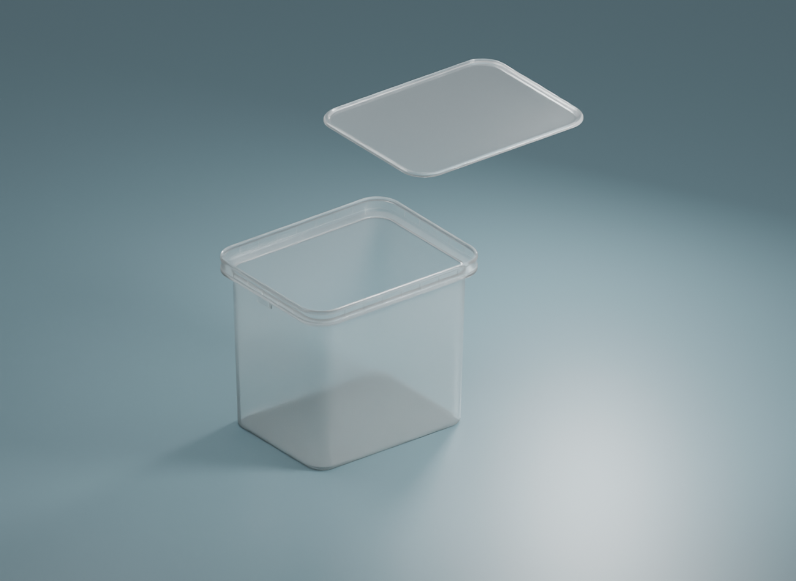
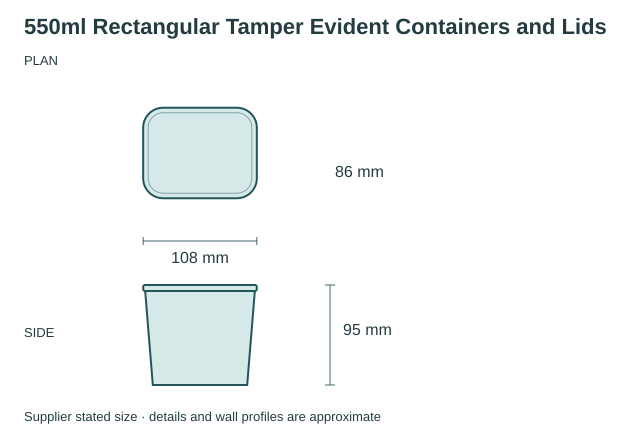

# 550ml Rectangular Tamper Evident Containers and Lids

Supplier dimensions 108 × 86 × 95 mm (supplier technical sheet, container dimensions).

The body taper, wall thickness, lid seating and tab use simplified estimates.

[Editable OpenSCAD](systempak_model.scad) · [Parameters and source](systempak_model.json) · [Seated lid](systempak_assembled.png)

[Supplier listing](https://systempak.net/product/550ml-rectangular-tamper-evident-containers-and-lids/) · [Technical sheet](https://systempak.net/wp-content/uploads/2024/03/TDS-214-550ML.pdf)

Regenerate with `python action_make_all.py --part packaging_takeaway_container_rectangle_550_ml_capacity_tamper_evident_systempak_214`.
